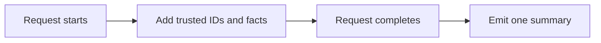

# Using logx

## Install

```sh
go get github.com/leetun2k2/go-bedrock/logx@latest
```

## Configure

Set `LoggerConfig.Production` to `true` for Zap's production format. The zero value uses Zap's development logger.

`ContextFields` adds a non-empty `contextx.KeyRequestID`. It also adds valid OpenTelemetry trace and span IDs, plus `trace_sampled` for sampled spans.

## Integrate

```go
package main

import (
	"context"
	"log"

	"github.com/leetun2k2/go-bedrock/contextx"
	"github.com/leetun2k2/go-bedrock/logx"
)

func main() {
	logger, err := logx.New(&logx.LoggerConfig{Production: true})
	if err != nil {
		log.Fatal(err)
	}

	ctx := contextx.SetRequestID(context.Background(), "req-123")
	logger.Info(ctx, "order accepted", "order_id", "order-456")
}
```

## Lifecycle

Create one logger during process setup and reuse it. Pass the active request or task context to each log method.

## Canonical request summaries

Enable `CanonicalLogging` in `restapix.Config` or `grpcx.Config`. It is disabled by default. Each enabled REST request or unary RPC emits one summary with `event=request_completed`, final status, `duration_ms`, and correlation IDs. Summaries bypass sampling; ordinary log calls keep their current behavior.

After authentication, copy trusted IDs from the derived context into the shared collector:

```go
ctx = contextx.SetUserID(ctx, "user-456")
ctx = contextx.SetSessionID(ctx, "session-789")
ctx = contextx.SetIdentityID(ctx, "identity-123")
logx.EnrichContext(ctx)
logx.AddFields(ctx, "order_id", "order-456")
```

`session_id` must be a non-secret session record ID. IDs are optional; missing IDs are omitted. Identity is never read from request headers or tokens. Call `EnrichContext` explicitly after deriving a context; parent contexts cannot see child values. It also captures the active OpenTelemetry span.



`AddFields` is safe for concurrent callers and does nothing outside an enabled request. Repeated fields use the last value. Empty identity strings remove the field. Invalid pairs, reserved transport/correlation keys, and Zap output keys are ignored. An unmatched HTTP route is logged as `unmatched`; raw URLs and query strings are excluded. gRPC error detail defaults to the status code, excluding raw error messages. Supply only sanitized business fields and keep their values immutable until completion.

Custom request boundaries may use `StartRequest` and `Request.Complete`. Completion is idempotent and ignores late enrichment. It attempts delivery once and contains logging panics; sink failures and process termination can still lose records. MCP, streams, and background job integration are not included.

## Avoid

- Do not pass secrets as fields.
- Do not pass an odd number of key-value arguments.
- Do not use `Fatal` in request code; it terminates the process.
- Do not use `Panic` for normal error handling.
