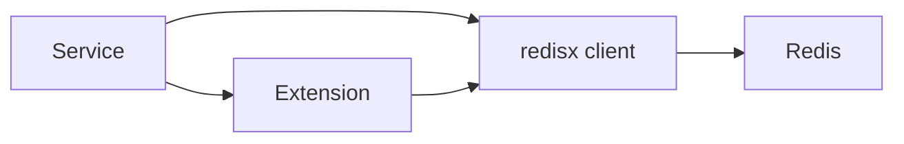

# redisx

`redisx` provides a standalone Redis client and focused extensions built on
`go-redis/v9`. The base client validates config, checks the connection with
`PING`, and integrates with the `serverx.Component` lifecycle.

## Extensions

| Package | Use | Redis requirement |
|---|---|---|
| [cachex](cachex/README.md) | Cache-aside with stampede control | Redis |
| [featurestorex](featurestorex/README.md) | Online feature hashes | Redis 7.4+ for field TTL |
| [leaderboardx](leaderboardx/README.md) | Ranked boards and metadata | Redis |
| [recommendx](recommendx/README.md) | Recommendation retrieval with filters | Redis Search |
| [memoryx](memoryx/README.md) | Agent state, semantic memory, and events | Redis Search and JSON |
| [prefetchx](prefetchx/README.md) | Bulk-loaded reference cache | Redis |
| [pubsubx](pubsubx/README.md) | Live channel broadcasts | Redis |
| [queuex](queuex/README.md) | At-least-once job queue | Redis |
| [ratelimitx](ratelimitx/README.md) | Distributed rate limits | Redis |
| [semanticcachex](semanticcachex/README.md) | LLM response cache by similarity | Redis Search |
| [sessionx](sessionx/README.md) | Server-side web sessions | Redis |
| [streamx](streamx/README.md) | Durable event consumers | Redis 6.2+ |
| [timeseriesx](timeseriesx/README.md) | Numeric time series and rollups | Redis TimeSeries |

All extensions borrow a Redis connection. Most accept `*redisx.Client`;
`sessionx` accepts its underlying `*redis.Client`. The application owns and
closes the base client. The module targets single-node Redis, not Redis Cluster.

See [USAGE.md](USAGE.md) for base client setup. Each extension has its own
`README.md` and `USAGE.md`.
