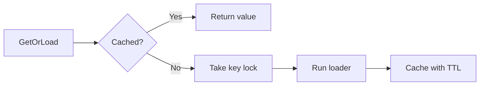

# cachex

`cachex` is a cache-aside store for opaque byte values. `GetOrLoad` uses a
short Redis lock to reduce load spikes when many callers miss the same key.

## API

- `Get` reads a value and returns `ErrNotFound` on a miss.
- `Set` writes a value with an explicit or default TTL.
- `GetOrLoad` loads and stores a missing value.
- `Delete` removes a value.

`Prefix` and `DefaultTTL` are required. `LockTTL` defaults to five seconds.
The cache borrows `redisx.Client` and is safe for concurrent use.

The loader may run again after the lock expires. Make it safe to repeat, and
set `LockTTL` longer than normal load time.

See [USAGE.md](USAGE.md) for setup.
