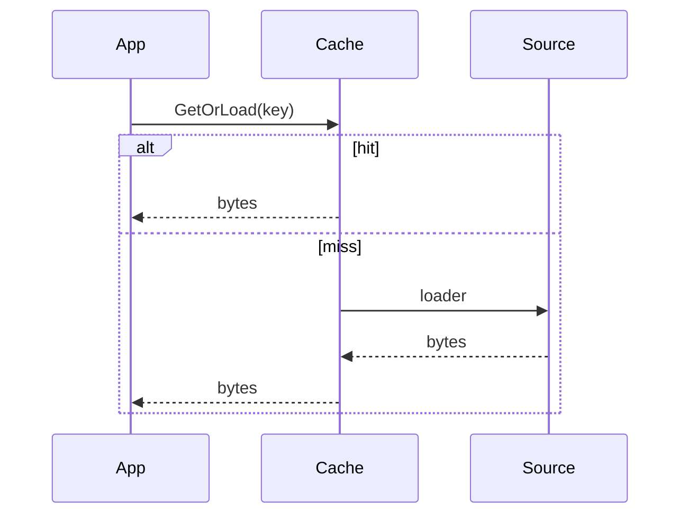

# Using cachex

## Create the cache

```go
cache, err := cachex.New(rdb, cachex.Config{
	Prefix:     "orders:product",
	DefaultTTL: 10 * time.Minute,
	LockTTL:    5 * time.Second,
})
if err != nil {
	return err
}
```

`rdb` is a shared `*redisx.Client`. See the parent [USAGE.md](../USAGE.md).

## Read through the cache

```go
raw, err := cache.GetOrLoad(ctx, productID, 0, func(ctx context.Context) ([]byte, error) {
	product, err := repo.FindProduct(ctx, productID)
	if err != nil {
		return nil, err
	}
	return json.Marshal(product)
})
if err != nil {
	return err
}
```

A TTL of zero or less uses `DefaultTTL`. A loader error is returned and is not
cached. A nil loader result is returned but is not cached.

## Direct operations

```go
if err := cache.Set(ctx, "product-1", payload, time.Minute); err != nil {
	return err
}

payload, err := cache.Get(ctx, "product-1")
if errors.Is(err, cachex.ErrNotFound) {
	return loadWithoutCache(ctx)
}

if err := cache.Delete(ctx, "product-1"); err != nil {
	return err
}
```



Use stable, non-secret keys. Cancel the context to stop waiting for a lock.
