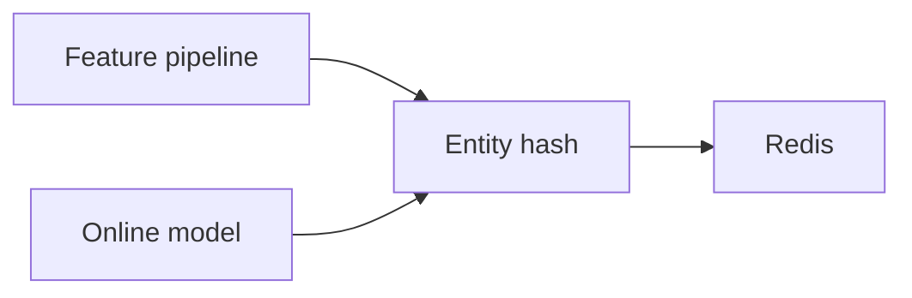

# featurestorex

`featurestorex` serves precomputed model features from one Redis hash per
entity. Values are strings, so the caller owns encoding and default values.

## API

- `Set` writes fields and can refresh the entity TTL.
- `SetWithTTL` gives written fields their own TTL.
- `Get` reads selected fields from one entity.
- `GetMany` pipelines reads for several entities.
- `Delete` removes an entity.

`Prefix` is required. `EntityTTL` is optional and must not be negative.
Missing or expired fields are omitted from results.

Per-field TTL uses `HEXPIRE` and needs Redis 7.4 or later. Plain `Set`, `Get`,
`GetMany`, and `Delete` do not need that command.

See [USAGE.md](USAGE.md) for examples.
