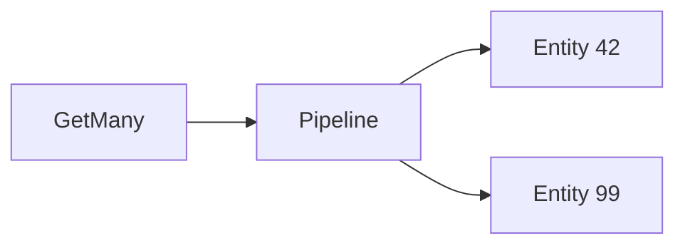

# Using featurestorex

`rdb` below is a shared `*redisx.Client` created as shown in the parent
[USAGE.md](../USAGE.md).

## Create the store

```go
features, err := featurestorex.New(rdb, featurestorex.Config{
	Prefix:    "recommendation:features",
	EntityTTL: 24 * time.Hour,
})
if err != nil {
	return err
}
```

## Write features

```go
err = features.Set(ctx, "user-42", map[string]string{
	"plan":       "pro",
	"order_count": "18",
})
```

Give selected fields their own expiry on Redis 7.4+:

```go
err = features.SetWithTTL(ctx, "user-42", map[string]string{
	"recent_score": "0.91",
}, 15*time.Minute)
```

## Read features

```go
values, err := features.Get(ctx, "user-42", "plan", "recent_score")
if err != nil {
	return err
}

score := values["recent_score"]
if score == "" {
	score = defaultScore
}
```

Read the same fields for many entities in one pipeline:

```go
rows, err := features.GetMany(
	ctx,
	[]string{"user-42", "user-99"},
	"plan",
	"recent_score",
)
```



The result order matches the entity input order. Missing fields are absent;
apply model defaults in the caller.
