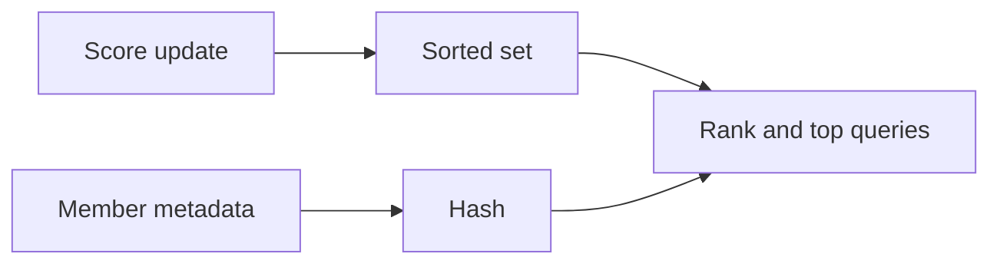

# leaderboardx

`leaderboardx` keeps named ranked boards in Redis sorted sets. Entries use
descending score order and may have JSON-encoded string metadata.

## API

- `SetScore` sets a member score.
- `Increment` adds to a score and returns the new value.
- `Rank` reads one member and returns `ErrNotFound` when absent.
- `Top` reads the highest ranked entries.
- `Around` reads entries around one member.
- `SetMetadata` and `GetMetadata` manage member details.
- `Remove` removes a score and its metadata.

`Prefix` is required. `TTL` is optional; score and metadata writes refresh the
TTL of the key they change. Ranks are zero-based. Ties follow Redis sorted-set
ordering.

See [USAGE.md](USAGE.md) for examples.
