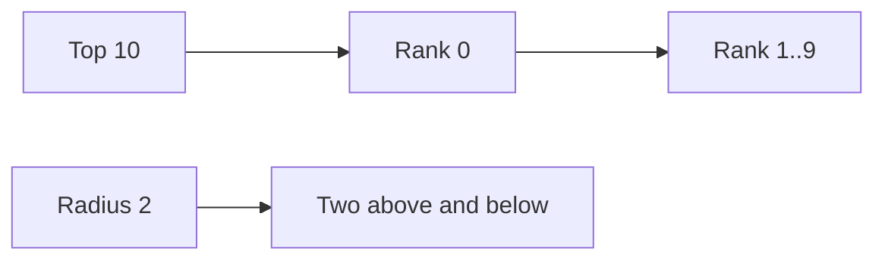

# Using leaderboardx

`rdb` below is a shared `*redisx.Client` created as shown in the parent
[USAGE.md](../USAGE.md).

## Create a leaderboard

```go
board, err := leaderboardx.New(rdb, leaderboardx.Config{
	Prefix: "game:leaderboard",
	TTL:    7 * 24 * time.Hour,
})
if err != nil {
	return err
}
```

A zero TTL keeps boards until they are removed from Redis.

## Update scores and metadata

```go
if err := board.SetScore(ctx, "weekly", "player-1", 1200); err != nil {
	return err
}

score, err := board.Increment(ctx, "weekly", "player-1", 25)

err = board.SetMetadata(ctx, "weekly", "player-1", map[string]string{
	"display_name": "Ada",
	"country":      "VN",
})
```

## Read ranks

```go
entry, err := board.Rank(ctx, "weekly", "player-1")
if errors.Is(err, leaderboardx.ErrNotFound) {
	return ErrUnranked
}

top, err := board.Top(ctx, "weekly", 10)
nearby, err := board.Around(ctx, "weekly", "player-1", 2)
```



`Entry.Rank` starts at zero. `Entry.Metadata` is nil when none was stored.

## Remove a member

```go
if err := board.Remove(ctx, "weekly", "player-1"); err != nil {
	return err
}
```

`Remove` is safe when the member is absent.
