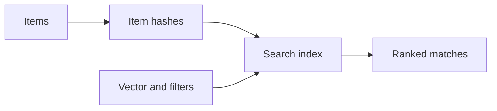

# matchingx

`matchingx` stores item vectors in Redis hashes and runs KNN searches with
optional tag and numeric filters.

## Requirements

- Redis Search with vector support.
- One fixed vector size per matcher.
- `COSINE`, `L2`, or `IP` distance. Empty means `COSINE`.

## API

- `CreateIndex` creates the search index.
- `UpsertItem` stores a vector and declared fields.
- `Match` returns nearest items in score order.
- `DeleteItem` removes an item.

`Prefix`, `IndexName`, and positive `Dimensions` are required. Tag and numeric
fields must be declared in config before use. Unsupported Search commands are
reported through `ErrCapability`.

See [USAGE.md](USAGE.md) for setup.
