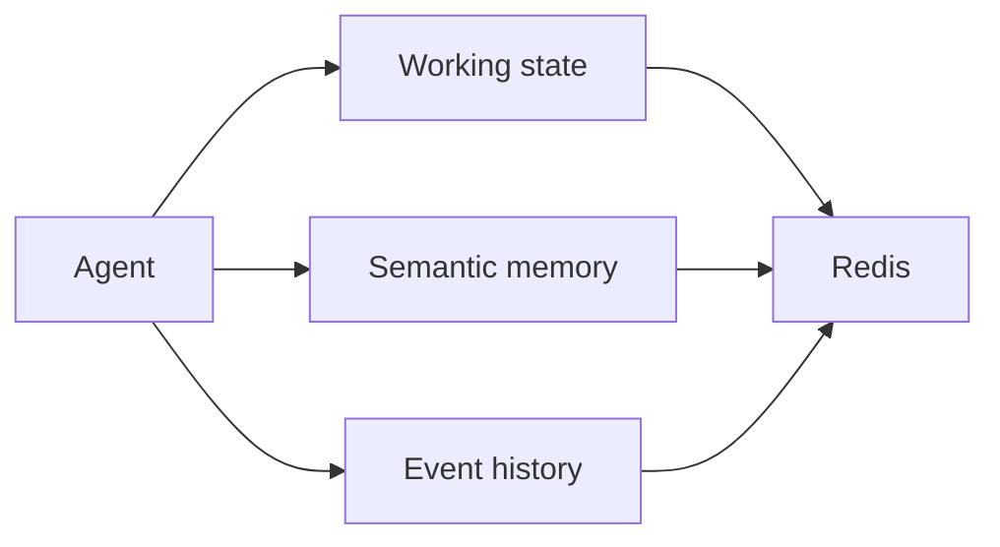

# memoryx

`memoryx` provides three explicit storage paths for an agent: short-lived
thread state, vector-searchable semantic memory, and bounded event history.

## Requirements

Working state and events use core Redis. Semantic memory needs Redis Search
and Redis JSON. `CreateIndex`, `Remember`, `Recall`, and `Forget` depend on
those modules.

## API

- `SaveState`, `LoadState`, and `DeleteState` manage expiring thread state.
- `CreateIndex`, `Remember`, `Recall`, and `Forget` manage semantic memory.
- `AppendEvent` and `RecentEvents` manage a bounded stream per thread.

`Prefix`, `IndexName`, positive `Dimensions`, `WorkingMemoryTTL`, and
`EventRetention` are required. Distance defaults to `COSINE`. A positive
`DedupThreshold` enables best-effort semantic duplicate checks.

See [USAGE.md](USAGE.md) for examples.
