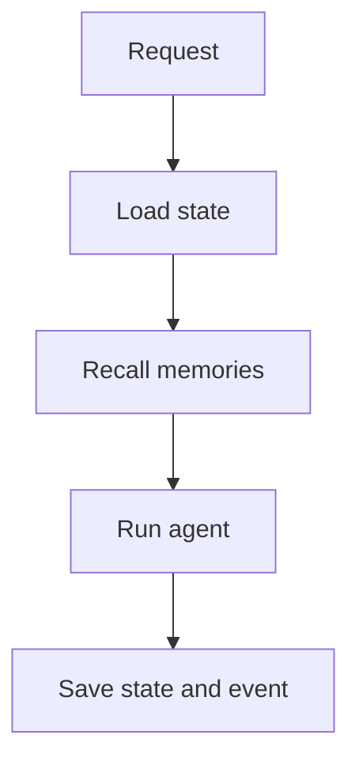

# Using memoryx

`rdb` below is a shared `*redisx.Client` created as shown in the parent
[USAGE.md](../USAGE.md).

## Create memory

```go
memory, err := memoryx.New(rdb, memoryx.Config{
	Prefix:           "assistant",
	IndexName:        "assistant-memory",
	Dimensions:       3,
	DistanceMetric:   "COSINE",
	DedupThreshold:   0.05,
	WorkingMemoryTTL: 30 * time.Minute,
	EventRetention:   1000,
})
if err != nil {
	return err
}

if err := memory.CreateIndex(ctx); err != nil {
	return err
}
```

Redis Search and JSON are required for the semantic methods.

## Working state

```go
err = memory.SaveState(ctx, "thread-42", map[string]string{
	"step":   "confirm_order",
	"locale": "en",
})

state, err := memory.LoadState(ctx, "thread-42")
if errors.Is(err, memoryx.ErrNotFound) {
	return startNewThread(ctx)
}
```

Each save writes the supplied fields and refreshes the TTL. Fields omitted from
a later save remain in the hash. Use `DeleteState` when a thread ends.

## Semantic memory

```go
id, stored, err := memory.Remember(ctx, memoryx.MemoryRecord{
	User:      "user-7",
	Namespace: "support",
	Kind:      "preference",
	Text:      "Prefers email updates",
	Vector:    []float32{0.2, 0.7, 0.1},
	Metadata:  map[string]string{"source": "chat"},
})
```

When dedup finds a close scoped record, `stored` is false and `id` is the old
record ID.

```go
records, err := memory.Recall(ctx, memoryx.RecallQuery{
	User:      "user-7",
	Namespace: "support",
	Kind:      "preference",
	Vector:    []float32{0.2, 0.68, 0.12},
	Limit:     5,
})
```

`Forget` requires the owning user and namespace, so an ID cannot delete data
from another scope.

## Event history

```go
_, err = memory.AppendEvent(ctx, "thread-42", "tool_called", map[string]interface{}{
	"tool": "lookup_order",
})

events, err := memory.RecentEvents(ctx, "thread-42", 20)
```



Recent events are returned oldest first. Handlers should treat module errors
wrapped with `memoryx.ErrCapability` as a deployment issue.
