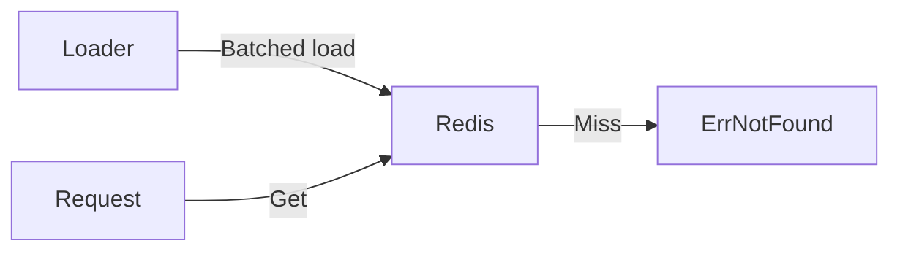

# prefetchx

`prefetchx` is a preloaded reference cache. Data is loaded before requests,
and reads never fall back to a source database.

## API

- `Load` writes items in bounded pipeline batches.
- `Get` reads a value and returns `ErrNotFound` on a miss.
- `Upsert` writes one value.
- `Delete` removes one value.

`Prefix`, positive `SafetyTTL`, and positive `BatchSize` are required. Every
write refreshes the key TTL. A stalled loader therefore cannot keep stale data
forever.

`Load` is not an atomic snapshot swap. Completed batches remain when a later
batch fails or the context is canceled.

See [USAGE.md](USAGE.md) for examples.
