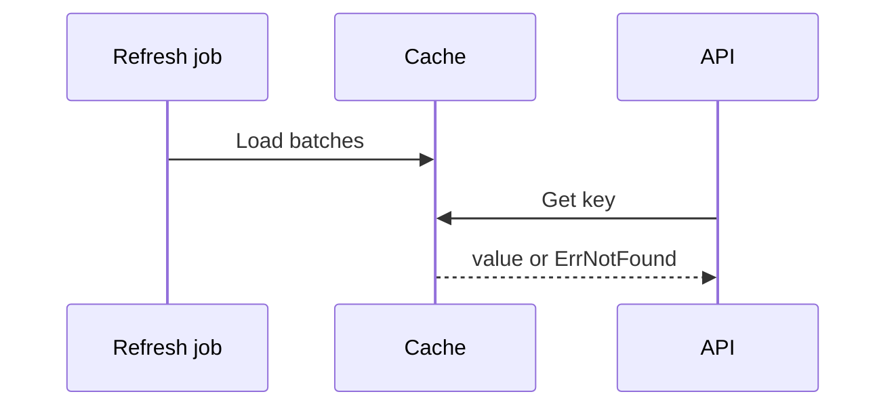

# Using prefetchx

`rdb` below is a shared `*redisx.Client` created as shown in the parent
[USAGE.md](../USAGE.md).

## Create the cache

```go
cache, err := prefetchx.New(rdb, prefetchx.Config{
	Prefix:    "catalog:country",
	SafetyTTL: 2 * time.Hour,
	BatchSize: 500,
})
if err != nil {
	return err
}
```

## Preload data

```go
items := []prefetchx.Item{
	{Key: "VN", Value: []byte("Vietnam")},
	{Key: "SG", Value: []byte("Singapore")},
}

if err := cache.Load(ctx, items); err != nil {
	return err
}
```

Run loads before serving traffic and refresh them before `SafetyTTL` expires.
Choose a batch size that limits pipeline memory and round-trip count.

## Read and update

```go
value, err := cache.Get(ctx, "VN")
if errors.Is(err, prefetchx.ErrNotFound) {
	return ErrReferenceDataUnavailable
}
if err != nil {
	return err
}

if err := cache.Upsert(ctx, "VN", []byte("Viet Nam")); err != nil {
	return err
}

if err := cache.Delete(ctx, "VN"); err != nil {
	return err
}
```



Do not use this package when a request-time source fallback is required; use
`cachex` for that flow.
