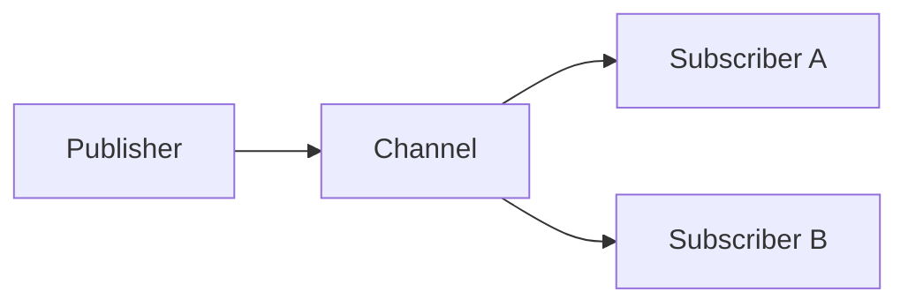

# pubsubx

`pubsubx` wraps Redis Pub/Sub for live channel and pattern broadcasts.

Messages are at-most-once. They are not stored, acknowledged, or replayed.
Disconnected or slow consumers can miss data. Use `streamx` when delivery and
recovery matter.

## API

- `Publish` sends bytes and returns the active receiver count.
- `Subscribe` listens to exact channel names.
- `PSubscribe` listens to channel patterns.
- `Subscription.Channel` yields messages.
- `Subscription.Close` stops delivery and is safe to repeat.

`Prefix` is optional. It is added to Redis channel names and removed from
delivered messages. The client and subscriptions are safe for concurrent use.

See [USAGE.md](USAGE.md) for examples.
