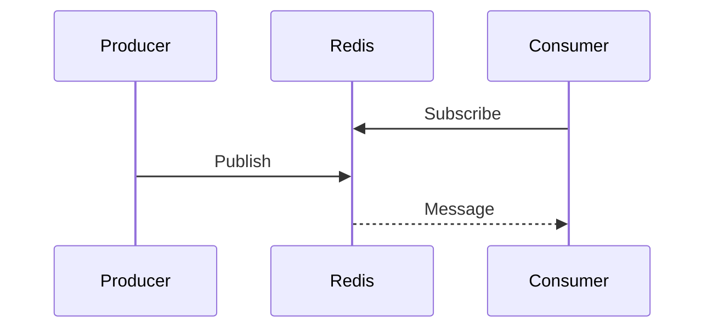

# Using pubsubx

`rdb` below is a shared `*redisx.Client` created as shown in the parent
[USAGE.md](../USAGE.md).

## Create the client

```go
bus, err := pubsubx.New(rdb, pubsubx.Config{Prefix: "orders"})
if err != nil {
	return err
}
```

## Subscribe

```go
sub, err := bus.Subscribe(ctx, "created", "canceled")
if err != nil {
	return err
}
defer sub.Close()

for msg := range sub.Channel() {
	if err := handle(msg.Channel, msg.Payload); err != nil {
		log.Printf("handle pubsub message: %v", err)
	}
}
```

The context or `Close` ends the subscription and closes its Go channel.

## Subscribe by pattern

```go
sub, err := bus.PSubscribe(ctx, "region:*")
if err != nil {
	return err
}
defer sub.Close()
```

Pattern deliveries set `Message.Pattern`. Exact subscriptions leave it empty.

## Publish

```go
receivers, err := bus.Publish(ctx, "created", payload)
if err != nil {
	return err
}
```

`receivers` is a point-in-time count, not a delivery receipt.



Keep reading `Subscription.Channel`; an unread unbuffered channel blocks that
subscription's delivery loop.
