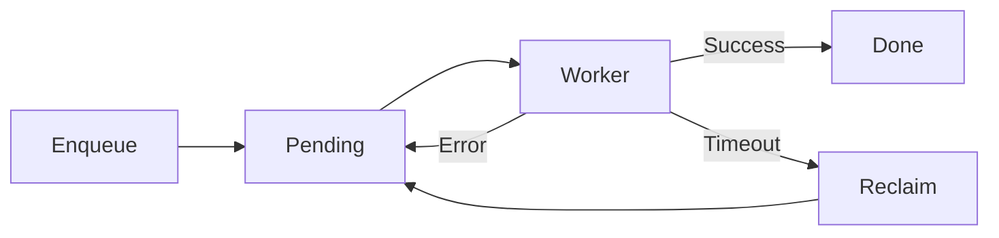

# queuex

`queuex` is a small at-least-once job queue backed by Redis lists, hashes, and
sorted sets. It uses claim tokens so stale workers cannot finish jobs reclaimed
after a visibility timeout.

## API

- `Enqueue` stores an opaque payload and returns a generated ID.
- `Consume` runs a fixed worker pool and a reclaimer.
- `Close` stops consumption and waits for workers.

`QueueName`, positive `VisibilityTimeout`, and positive `WorkerCount` are
required. `Prefix` is optional. A handler error returns the job to pending.
Expired claims are also returned to pending.

Delivery is at-least-once. Handlers must be idempotent. The queue has no retry
limit, delay schedule, or dead-letter queue.

See [USAGE.md](USAGE.md) for setup.
