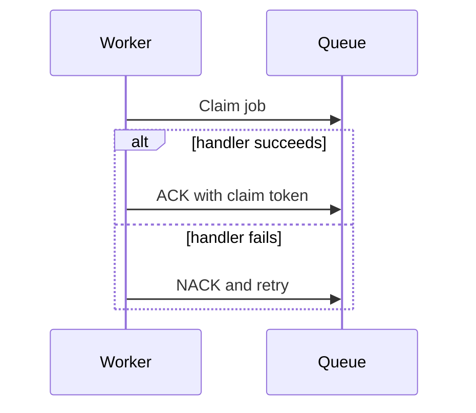

# Using queuex

`rdb` below is a shared `*redisx.Client` created as shown in the parent
[USAGE.md](../USAGE.md).

## Create the queue

```go
queue, err := queuex.New(rdb, queuex.Config{
	Prefix:            "orders",
	QueueName:         "email",
	VisibilityTimeout: 30 * time.Second,
	WorkerCount:       4,
})
if err != nil {
	return err
}
```

Set `VisibilityTimeout` above normal handler time. A long job can be reclaimed
and run again while its first handler still runs.

## Enqueue

```go
payload, err := json.Marshal(sendEmailJob{OrderID: "order-42"})
if err != nil {
	return err
}

jobID, err := queue.Enqueue(ctx, payload)
if err != nil {
	return err
}
```

## Consume

```go
err = queue.Consume(ctx, func(ctx context.Context, job queuex.Job) error {
	var payload sendEmailJob
	if err := json.Unmarshal(job.Payload, &payload); err != nil {
		return err
	}

	return mailer.SendOnce(ctx, job.ID, payload.OrderID)
})
```

`Consume` blocks until its context is canceled or `Close` is called. Only one
`Consume` call may run on one `Queue` value.



`Job.Attempts` counts earlier NACK or reclaim operations. It is zero on the
first delivery. Use `Job.ID` as an idempotency key for external effects.

## Shutdown

```go
cancel()
if err := queue.Close(); err != nil {
	return err
}
```

The base Redis client must remain open until `Consume` has stopped.
