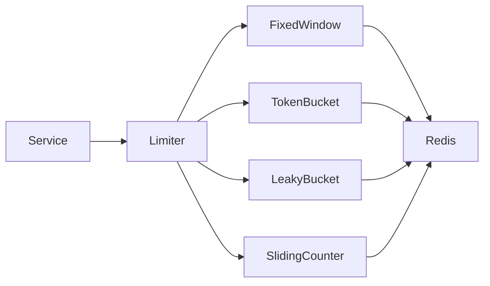
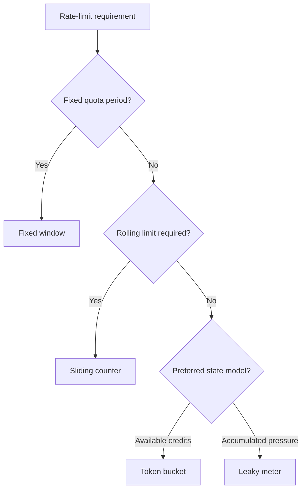

# ratelimitx

`ratelimitx` provides distributed rate limiting for services that share a standalone Redis instance.

It exposes one small `Limiter` contract and four explicit algorithms:

| Algorithm | Best use | State per key | Cost per decision |
|---|---|---:|---:|
| Fixed window | Simple quota by minute, hour, or day | One counter | `O(1)` |
| Token bucket | General API rate limiting with controlled bursts | Tokens and timestamp | `O(1)` |
| Leaky bucket meter | Reject traffic after bounded pressure accumulates | Occupancy and timestamp | `O(1)` |
| Sliding window counter | Rolling limits without per-request history | Two counters | `O(1)` |

Every decision uses Redis server time and one atomic Lua script. Concurrent service instances cannot spend the same remaining capacity.



## API

All algorithms implement the same interface:

```go
type Limiter interface {
	Allow(ctx context.Context, key string, cost int64) (Result, error)
}
```

`Allow` returns:

- `Allowed`: whether Redis admitted the requested cost.
- `Remaining`: units available at the current instant.
- `RetryAfter`: wait before the same cost may pass if no other request is admitted.

Clients select behavior through an explicit constructor:

- `NewFixedWindow`
- `NewTokenBucket`
- `NewLeakyBucket`
- `NewSlidingWindowCounter`

There is no generic factory or runtime algorithm switch.

## Choosing an algorithm



Use token bucket as the default for API traffic. Use fixed window when boundary bursts are acceptable. Use sliding window counter when a rolling estimate matters. Use leaky bucket meter when accumulated pressure should drain at a fixed rate.

Leaky bucket meter does not queue or pace accepted work. Strict output pacing requires a queue and worker outside this package.

## Guarantees

- One Redis round trip per decision.
- Constant work and bounded state per active key.
- Atomic admission for concurrent callers.
- Redis server time across all service instances.
- Weighted request cost for every algorithm.
- Automatic expiry of inactive state.
- State isolation through an algorithm-specific configured prefix.

## Constraints

- Redis is required for every decision. The caller owns fail-open or fail-closed policy.
- Durations must be at least one millisecond and must be whole-millisecond values.
- `cost`, limits, capacities, refill amounts, and leak amounts must be positive.
- A cost above the configured limit or capacity is invalid.
- Sliding window counter is approximate and rounds conservatively.
- Different algorithms must not share the same prefix and subject key.
- The package targets standalone Redis through `redisx.Client`; Redis Cluster is not supported.

See [USAGE.md](USAGE.md) for setup and examples.
