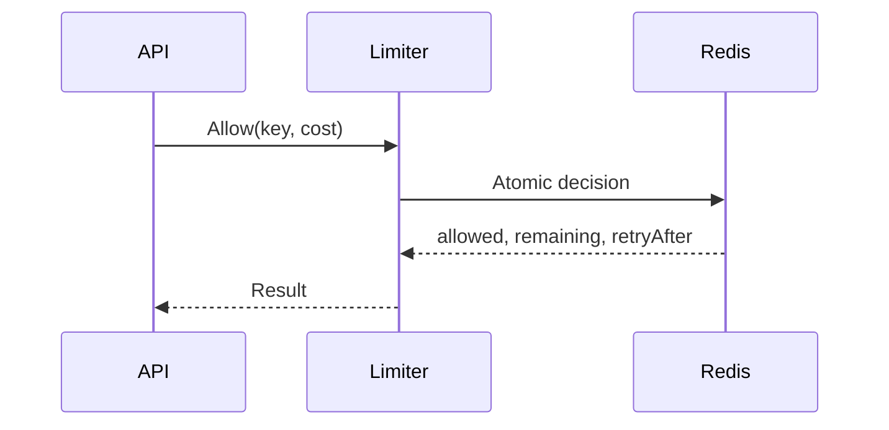

# Using ratelimitx

## Install

```sh
go get github.com/leetun2k2/go-bedrock/redisx@latest
```

## Create the Redis client

All limiters borrow a shared `redisx.Client`. Closing a limiter does not close Redis; the application owns the client lifecycle.

```go
ctx := context.Background()

rdb, err := redisx.New(ctx, redisx.Config{
	Addr:     "127.0.0.1:6379",
	Password: os.Getenv("REDIS_PASSWORD"),
})
if err != nil {
	log.Fatal(err)
}
defer rdb.Close()
```

## Request flow



## Fixed window

Use fixed window for a simple quota such as 100 accepted units per minute. Windows align to time boundaries based on Redis server time.

```go
limiter, err := ratelimitx.NewFixedWindow(rdb, ratelimitx.FixedWindowConfig{
	Prefix: "orders-api:fixed",
	Limit:  100,
	Window: time.Minute,
})
if err != nil {
	log.Fatal(err)
}
```

The counter resets at the next window boundary. Traffic may burst across that boundary.

## Token bucket

Use token bucket for normal API traffic that may burst within a controlled capacity.

```go
limiter, err := ratelimitx.NewTokenBucket(rdb, ratelimitx.TokenBucketConfig{
	Prefix:         "orders-api:token",
	Capacity:       20,
	RefillAmount:   5,
	RefillInterval: time.Second,
})
if err != nil {
	log.Fatal(err)
}
```

The bucket starts with 20 tokens. It adds 5 tokens after each complete second and never exceeds 20.

## Leaky bucket meter

Use leaky bucket meter when accepted cost should accumulate as pressure and drain at a fixed rate.

```go
limiter, err := ratelimitx.NewLeakyBucket(rdb, ratelimitx.LeakyBucketConfig{
	Prefix:       "partner-api:leaky",
	Capacity:     20,
	LeakAmount:   5,
	LeakInterval: time.Second,
})
if err != nil {
	log.Fatal(err)
}
```

The bucket starts empty. Accepted cost increases occupancy. Five units drain after each complete second. Calls that would exceed capacity are rejected.

This limiter does not hold requests or make downstream execution run at a constant pace. Use a queue and worker for that behavior.

## Sliding window counter

Use sliding window counter when the active rolling period matters more than exact request history.

```go
limiter, err := ratelimitx.NewSlidingWindowCounter(rdb, ratelimitx.SlidingWindowCounterConfig{
	Prefix: "login-api:sliding",
	Limit:  100,
	Window: time.Minute,
})
if err != nil {
	log.Fatal(err)
}
```

The limiter combines the current counter with a weighted part of the previous counter. It rounds conservatively and may reject up to one unit earlier than an exact sliding log.

## Check a request

The key identifies the subject being limited. It may represent a tenant, user, API key, or IP address.

```go
result, err := limiter.Allow(ctx, "tenant:acme", 1)
if err != nil {
	return fmt.Errorf("check rate limit: %w", err)
}

if !result.Allowed {
	return fmt.Errorf("rate limited; retry after %s", result.RetryAfter)
}

log.Printf("remaining capacity: %d", result.Remaining)
```

## Use weighted cost

Every algorithm supports weighted work. A cheap read may cost one unit while an expensive export costs ten.

```go
cost := int64(1)
if operation == "export" {
	cost = 10
}

result, err := limiter.Allow(ctx, "tenant:acme", cost)
if err != nil {
	return err
}
```

A cost above the configured limit or capacity returns an error without touching Redis.

## Handle Redis failure

`ratelimitx` returns Redis and context errors. It does not silently allow or reject traffic. The caller must choose a policy that matches the endpoint risk.

Fail closed for sensitive operations:

```go
result, err := limiter.Allow(ctx, key, cost)
if err != nil {
	return err
}
if !result.Allowed {
	return ErrRateLimited
}
```

Fail open only when availability is more important than enforcement:

```go
result, err := limiter.Allow(ctx, key, cost)
if err != nil {
	return handleRequest(ctx)
}
if !result.Allowed {
	return ErrRateLimited
}
```

Keep this policy in the service. Do not hide it inside a shared limiter wrapper.

## Configuration rules

- Use a stable prefix for one application, algorithm, and policy.
- Use a distinct prefix for each algorithm.
- Use bounded keys. Do not include raw secrets or unbounded payload data.
- Keep each duration at one millisecond or longer.
- Use whole-millisecond durations; sub-millisecond parts are rejected, not rounded.
- Keep all numeric limits and rates positive.
- Use a different prefix when changing a policy must start with clean state.
- Do not share the same prefix between unrelated environments.

## Result semantics

| Field | Allowed call | Rejected call |
|---|---|---|
| `Allowed` | `true` | `false` |
| `Remaining` | Capacity left after admission | Capacity available now |
| `RetryAfter` | `0` | Wait before the same cost may pass |

`RetryAfter` assumes no other request is admitted for the same key during the wait.
