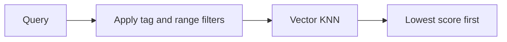

# Using recommendx

Use Redis Stack or another Redis deployment with Redis Search.
`rdb` below is a shared `*redisx.Client` created as shown in the parent
[USAGE.md](../USAGE.md).

## Create the recommender and index

```go
recommender, err := recommendx.New(rdb, recommendx.Config{
	Prefix:         "catalog:item",
	IndexName:      "catalog-items",
	Dimensions:     3,
	DistanceMetric: "COSINE",
	TagFields:      []string{"category", "region"},
	NumericFields:  []string{"price"},
})
if err != nil {
	return err
}

if err := recommender.CreateIndex(ctx); err != nil {
	return err
}
```

Call `CreateIndex` during deployment or startup. Reusing a compatible index is
safe. Changing its schema needs an explicit index migration.

## Store items

```go
err = recommender.UpsertItem(ctx, recommendx.Item{
	ID:     "item-42",
	Vector: []float32{0.12, 0.83, 0.44},
	TagFields: map[string]string{
		"category": "book",
		"region":   "vn",
	},
	NumericFields: map[string]float64{"price": 19.50},
})
```

The vector length must match `Dimensions`. Fields not declared in config are
rejected.

## Recommend

```go
results, err := recommender.Recommend(ctx, recommendx.Query{
	Vector:     []float32{0.10, 0.80, 0.40},
	Limit:      10,
	TagFilters: map[string]string{"category": "book"},
	NumericFilters: map[string][2]float64{
		"price": {10, 30},
	},
})
if errors.Is(err, recommendx.ErrCapability) {
	return ErrSearchUnavailable
}
```



Use `DeleteItem(ctx, id)` to remove an item. Keep embeddings from the same
model and version in one index.
