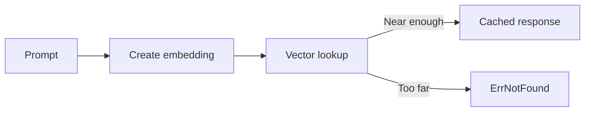

# semanticcachex

`semanticcachex` caches LLM responses by prompt embedding similarity. Lookup
finds the nearest entry in the same tenant and optional locale and model scope.

## Requirements

- Redis Search with vector support.
- One embedding model and vector size per index.
- `COSINE`, `L2`, or `IP` distance. Empty means `COSINE`.

## API

- `CreateIndex` creates the Redis Search index.
- `Set` writes an entry with an expiry.
- `Lookup` returns the nearest accepted entry.
- `Delete` removes one entry.
- `ClearNamespace` removes all entries for one tenant.

`Prefix`, `IndexName`, positive `Dimensions`, `Threshold`, and `TTL` are
required. `Lookup` returns `ErrNotFound` when no result is within the threshold.
Unsupported Search commands are reported through `ErrCapability`.

See [USAGE.md](USAGE.md) for examples.
