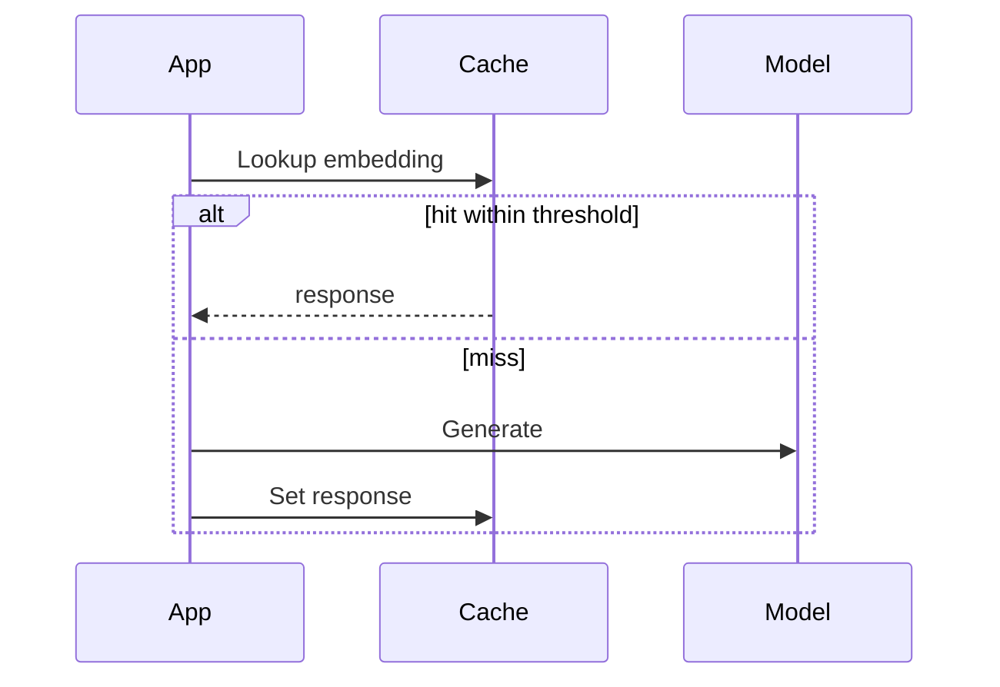

# Using semanticcachex

Use Redis Stack or another Redis deployment with Redis Search.
`rdb` below is a shared `*redisx.Client` created as shown in the parent
[USAGE.md](../USAGE.md).

## Create the cache and index

```go
cache, err := semanticcachex.New(rdb, semanticcachex.Config{
	Prefix:         "llm:cache",
	IndexName:      "llm-cache",
	Dimensions:     3,
	DistanceMetric: "COSINE",
	Threshold:      0.1,
	TTL:            6 * time.Hour,
})
if err != nil {
	return err
}

if err := cache.CreateIndex(ctx); err != nil {
	return err
}
```

Keep one embedding model and version per index. Tune `Threshold` with real
queries; its meaning depends on the distance metric and embedding model.

## Store a response

```go
err = cache.Set(ctx, semanticcachex.Entry{
	ID:        "request-42",
	Prompt:    "Where is my order?",
	Embedding: []float32{0.2, 0.7, 0.1},
	Response:  []byte("Your order is in transit."),
	Tenant:    "acme",
	Locale:    "en",
	Model:     "support-v2",
}, 0)
```

An empty ID is generated internally. A TTL of zero or less uses the configured
default.

## Look up a response

```go
entry, err := cache.Lookup(ctx, semanticcachex.LookupRequest{
	Embedding: []float32{0.21, 0.69, 0.11},
	Tenant:    "acme",
	Locale:    "en",
	Model:     "support-v2",
})
if errors.Is(err, semanticcachex.ErrNotFound) {
	return callModel(ctx)
}
if err != nil {
	return err
}
```

Tenant is required. Empty locale or model values do not filter that field.



Use `Delete(ctx, id)` for one entry or `ClearNamespace(ctx, tenant)` for a
tenant-wide purge.
