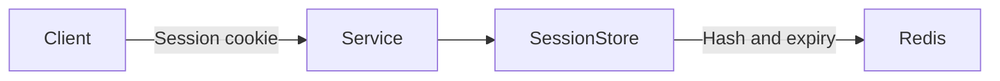
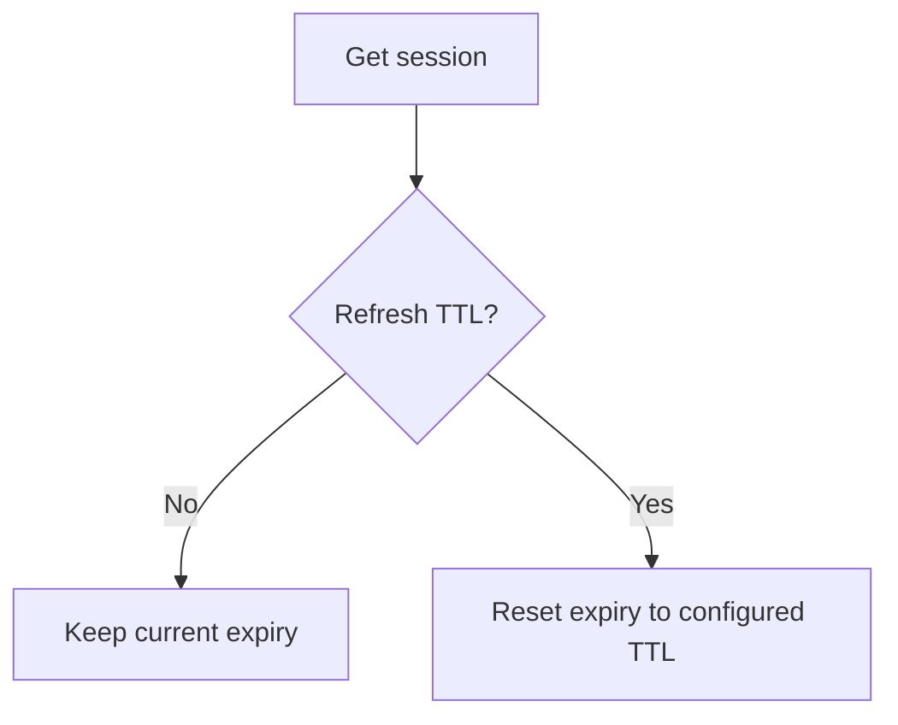

# sessionx

`sessionx` stores server-side web sessions in Redis hashes.

It creates opaque session IDs, stores string fields, tracks session metadata, and removes expired sessions through Redis key expiry. The caller owns the HTTP cookie and the Redis client lifecycle.

## Behavior

- Session IDs use 32 random bytes and URL-safe base64 encoding.
- Redis keys use `<prefix><session-id>`.
- The default prefix is `session:`.
- The default TTL is 1,800 seconds.
- A TTL of `0` selects the store default.
- Redis deletes a session after its TTL expires.
- Reads can keep the current expiry or refresh it.
- Updates, increments, and TTL changes refresh the expiry.
- The store borrows `*redis.Client`; it does not close it.

## API

| Method | Purpose |
|---|---|
| `CreateSession` | Create a session and return its generated ID. |
| `GetSession` | Read a session and optionally refresh its TTL. |
| `UpdateSession` | Set custom fields and refresh the TTL. |
| `IncrementField` | Increment a numeric custom field and refresh the TTL. |
| `SetSessionTTL` | Change the stored TTL and apply it now. |
| `GetConfiguredTTL` | Read the TTL configured for future refreshes. |
| `GetTTL` | Read the current Redis expiry in whole seconds. |
| `DeleteSession` | Delete one session. |

Methods that return `found bool` use `false` when the session is missing, expired, or lacks required metadata.

## Expiry modes

Use `GetSession(ctx, id, false)` for fixed expiry. Use `GetSession(ctx, id, true)` for sliding expiry.

Each session stores its own configured TTL. `SetSessionTTL` changes that value for later refreshes and resets the current expiry at once.

## Reserved fields

The store owns these hash fields:

| Field | Meaning |
|---|---|
| `created_at` | Creation time in UTC. |
| `last_accessed_at` | Last refreshing read or change in UTC. |
| `session_ttl` | Configured TTL in seconds. |

`CreateSession` and `UpdateSession` ignore caller values for reserved fields. Never pass a reserved field to `IncrementField`.

## Constraints

- Field names and values are strings.
- TTL values must be at least one second.
- `NewRedisSessionStore` panics when the Redis client is nil or the configured TTL is negative.
- An update with no custom fields does not refresh the TTL.
- `IncrementField` fails if the stored field is not an integer.
- Redis and context errors are returned to the caller.
- `sessionx` does not create, sign, set, or clear HTTP cookies.
- The package does not provide user-wide session lookup or revocation.

See [USAGE.md](USAGE.md) for setup and examples.
