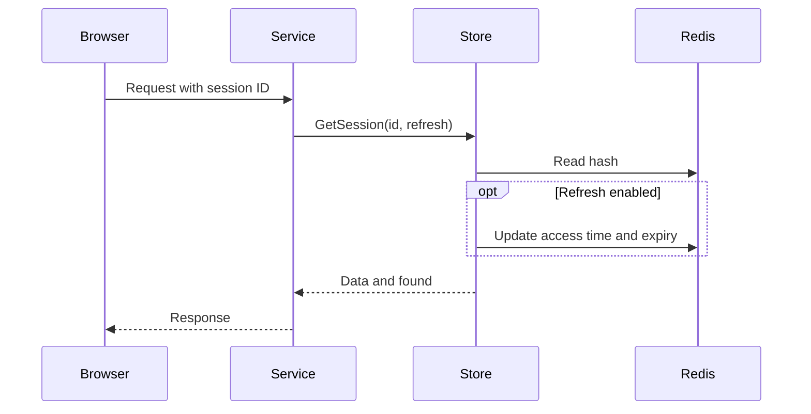

# Using sessionx

## Install

```sh
go get github.com/leetun2k2/go-bedrock/redisx@latest
```

## Create the store

Create one shared Redis client and pass its underlying `*redis.Client` to the session store.

```go
ctx := context.Background()

rdb, err := redisx.New(ctx, redisx.Config{
	Addr:     "127.0.0.1:6379",
	Password: os.Getenv("REDIS_PASSWORD"),
})
if err != nil {
	log.Fatal(err)
}
defer rdb.Close()

sessions := sessionx.NewRedisSessionStore(rdb.Client(), sessionx.SessionStoreConfig{
	Prefix: "orders:session:",
	TTL:    30 * 60,
})
```

`TTL` is in seconds. A zero `Prefix` uses `session:`. A zero `TTL` uses 1,800 seconds.

The application owns the Redis client. The session store does not close it.

## Session flow



## Create a session

Pass `0` to use the store default TTL. The returned ID is opaque and safe for a cookie value.

```go
sessionID, err := sessions.CreateSession(ctx, map[string]string{
	"user_id": "user-123",
	"role":    "member",
}, 0)
if err != nil {
	return fmt.Errorf("create session: %w", err)
}

http.SetCookie(w, &http.Cookie{
	Name:     "session_id",
	Value:    sessionID,
	Path:     "/",
	MaxAge:   30 * 60,
	HttpOnly: true,
	Secure:   true,
	SameSite: http.SameSiteLaxMode,
})
```

Pass a positive TTL to override the store default for one session:

```go
sessionID, err := sessions.CreateSession(ctx, data, 15*60)
```

The Redis expiry is authoritative. Keep the cookie lifetime aligned with it.

## Read a session

Use `refreshTTL=true` for sliding expiry.

```go
data, found, err := sessions.GetSession(ctx, sessionID, true)
if err != nil {
	return fmt.Errorf("get session: %w", err)
}
if !found {
	return ErrUnauthenticated
}

userID := data["user_id"]
```

Use `refreshTTL=false` when reads must not extend the session:

```go
data, found, err := sessions.GetSession(ctx, sessionID, false)
```

The returned map includes the three reserved metadata fields.

## Update fields

An update refreshes the session with its stored configured TTL.

```go
updated, err := sessions.UpdateSession(ctx, sessionID, map[string]string{
	"role": "admin",
})
if err != nil {
	return fmt.Errorf("update session: %w", err)
}
if !updated {
	return ErrUnauthenticated
}
```

Do not use an empty map only to refresh a session. Use a refreshing read instead.

## Increment a numeric field

```go
attempts, found, err := sessions.IncrementField(ctx, sessionID, "login_attempts", 1)
if err != nil {
	return fmt.Errorf("increment login attempts: %w", err)
}
if !found {
	return ErrUnauthenticated
}
```

The field must be absent or contain an integer. Never increment `created_at`, `last_accessed_at`, or `session_ttl`.

## Change the TTL

`SetSessionTTL` saves the new configured TTL and applies it at once. Pass `0` to restore the store default.

```go
updated, err := sessions.SetSessionTTL(ctx, sessionID, 60*60)
if err != nil {
	return fmt.Errorf("set session TTL: %w", err)
}
if !updated {
	return ErrUnauthenticated
}
```

Read the stored TTL used by later refreshes:

```go
configuredTTL, found, err := sessions.GetConfiguredTTL(ctx, sessionID)
```

Read the current Redis countdown:

```go
remainingTTL, err := sessions.GetTTL(ctx, sessionID)
```

Both values are whole seconds. They differ after time has passed since the last refresh.

## Delete a session

Delete the Redis session during logout, then expire the browser cookie.

```go
_, err := sessions.DeleteSession(ctx, sessionID)
if err != nil {
	return fmt.Errorf("delete session: %w", err)
}

http.SetCookie(w, &http.Cookie{
	Name:     "session_id",
	Value:    "",
	Path:     "/",
	MaxAge:   -1,
	HttpOnly: true,
	Secure:   true,
	SameSite: http.SameSiteLaxMode,
})
```

`DeleteSession` returns `true` only when Redis deleted an existing key.

## Security rules

- Send cookies only over HTTPS.
- Set `HttpOnly`, `Secure`, and a suitable `SameSite` mode.
- Create a new session after login or privilege changes, then delete the old session.
- Do not log session IDs or place them in URLs.
- Do not accept session IDs from request fields other than the chosen cookie or header.
- Use TLS and access controls when Redis is outside a trusted network.
- Keep sensitive data out of session fields unless storage controls meet its needs.

## Error policy

Treat `found=false` as an expired or invalid session. Treat a Redis or context error as a dependency failure and choose fail-closed behavior for authentication.

```go
data, found, err := sessions.GetSession(ctx, sessionID, true)
if err != nil {
	return ErrSessionServiceUnavailable
}
if !found {
	return ErrUnauthenticated
}
```
