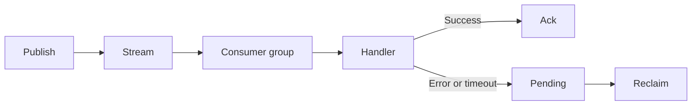

# streamx

`streamx` provides durable, at-least-once event handling with Redis Streams
and consumer groups. It reads new entries and reclaims stale pending entries.

## API

- `Publish` appends an event and returns its stream ID.
- `Consume` runs a reader, stale-entry reclaimer, and bounded handlers.
- `Close` stops consumption and waits for in-flight handlers.

`Stream`, `Group`, `Consumer`, positive `Concurrency`, `MinIdleTime`,
`ClaimInterval`, and `HandlerTimeout` are required. `BlockTimeout` defaults to
one second. `MaxLen` of zero disables publish-time trimming.

Handlers receive a context with `HandlerTimeout` as its deadline and are
acknowledged only after they return success. Delivery is at-least-once, so
handlers must honor the context and be idempotent. Stale reclaim uses
`XAUTOCLAIM` and needs Redis 6.2 or later.

See [USAGE.md](USAGE.md) for examples.
