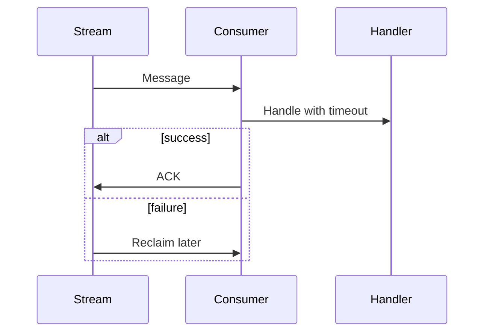

# Using streamx

`rdb` below is a shared `*redisx.Client` created as shown in the parent
[USAGE.md](../USAGE.md).

## Create a stream client

```go
events, err := streamx.New(rdb, streamx.Config{
	Stream:         "orders:events",
	Group:          "billing",
	Consumer:       hostname,
	MaxLen:         100000,
	Concurrency:    8,
	MinIdleTime:    time.Minute,
	ClaimInterval:  15 * time.Second,
	HandlerTimeout: 20 * time.Second,
	BlockTimeout:   time.Second,
})
if err != nil {
	return err
}
```

Use a stable group name per logical service and a unique consumer name per
running instance.

## Publish

```go
id, err := events.Publish(ctx, map[string]interface{}{
	"type":     "order.created",
	"order_id": "order-42",
})
if err != nil {
	return err
}
```

`MaxLen` uses approximate trimming. It bounds growth but is not an exact cap.

## Consume

```go
err = events.Consume(ctx, func(ctx context.Context, msg streamx.Message) error {
	orderID, ok := msg.Values["order_id"].(string)
	if !ok {
		return ErrInvalidEvent
	}

	return billing.ApplyOnce(ctx, msg.ID, orderID)
})
```

`Consume` blocks until canceled or closed. Only one call may run on one client.
A handler error leaves the message pending for later reclaim. The handler must
honor its context deadline; shutdown waits for in-flight handlers to return.



Set `MinIdleTime` above normal handler time to avoid reclaiming active work.
Use the message ID as an idempotency key.

## Shutdown

Cancel the consume context or call `events.Close()`. Keep the shared Redis
client open until `Consume` returns.
