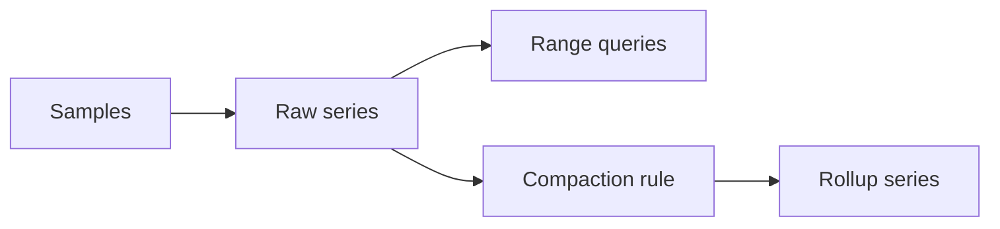

# timeseriesx

`timeseriesx` stores numeric samples with Redis TimeSeries. It supports bounded
retention, range queries, label filters, aggregation, and compaction rules.

## Requirements

Redis TimeSeries commands must be available. Missing module commands are
reported through `ErrCapability`.

## API

- `Create` creates a labeled series.
- `Add` appends one sample.
- `Range` reads one series.
- `MultiRange` reads series matching label filters.
- `CreateRule` creates a downsampling rule.

`Prefix` is required and is also stored as a hidden label. `MultiRange` always
scopes results to that prefix. Timestamps use Unix milliseconds.

Supported duplicate policies are `BLOCK`, `FIRST`, `LAST`, `MIN`, `MAX`, and
`SUM`. Supported aggregators include `AVG`, `SUM`, `MIN`, `MAX`, `COUNT`,
`FIRST`, `LAST`, standard deviation, variance, and `TWA`.

See [USAGE.md](USAGE.md) for examples.
