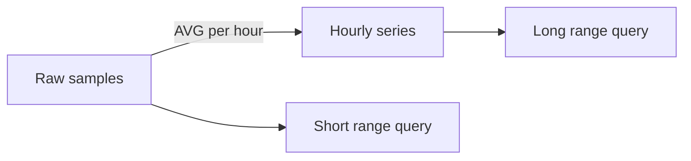

# Using timeseriesx

Use Redis Stack or another Redis deployment with Redis TimeSeries.
`rdb` below is a shared `*redisx.Client` created as shown in the parent
[USAGE.md](../USAGE.md).

## Create the client and series

```go
series, err := timeseriesx.New(rdb, timeseriesx.Config{
	Prefix: "metrics",
})
if err != nil {
	return err
}

err = series.Create(ctx, "cpu:host-1", timeseriesx.CreateOptions{
	Retention:       7 * 24 * time.Hour,
	DuplicatePolicy: "LAST",
	Labels: map[string]string{
		"type": "cpu",
		"host": "host-1",
	},
})
```

A zero retention lets Redis keep samples without a time limit.

## Add samples

```go
timestamp, err := series.Add(ctx, "cpu:host-1", 0, 42.5)
```

A timestamp of zero or less asks Redis to use server time. Positive timestamps
are Unix milliseconds.

## Read a range

```go
samples, err := series.Range(ctx, "cpu:host-1", -1, 1, timeseriesx.RangeOptions{
	Aggregator:     "AVG",
	BucketDuration: time.Minute,
	Count:          60,
})
```

For range bounds, `-1` means earliest and `1` means latest. An aggregator and
positive bucket duration must be set together.

## Read several labeled series

```go
rows, err := series.MultiRange(ctx, -1, 1, timeseriesx.MultiRangeOptions{
	Filters: []string{"type=cpu"},
	RangeOptions: timeseriesx.RangeOptions{
		Aggregator:     "AVG",
		BucketDuration: 5 * time.Minute,
	},
})
```

The client adds its own prefix label filter. Returned keys do not include the
configured prefix.

## Create a rollup

Create both source and destination series first, then add the rule:

```go
err = series.CreateRule(
	ctx,
	"cpu:host-1",
	"cpu:host-1:hourly",
	"AVG",
	time.Hour,
)
```



Handle `errors.Is(err, timeseriesx.ErrCapability)` as a deployment or server
capability issue.
