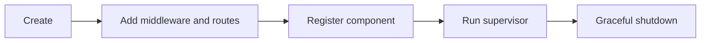

# Using restapix

## Install

```sh
go get github.com/leetun2k2/go-bedrock/restapix@latest
```

## Configure

- `Addr` defaults to `:5000`.
- `ReadHeaderTimeout` defaults to 5 seconds.
- `IdleTimeout` defaults to 60 seconds.
- `ReadTimeout` and `WriteTimeout` are disabled by default. Set them only when whole-request deadlines are safe.
- An empty `TrustedProxies` list trusts no proxy. Add only known proxy IPs or CIDRs.

Negative timeout values are rejected.

Set `CanonicalLogging` to `true` to emit one unsampled request summary. It is disabled by default. Summaries include the route template, final status, duration, and correlation IDs, including for rejected requests, unmatched routes, and recovered panics. They exclude raw URLs, query strings, and request bodies.

`Start` installs the complete handler automatically. When serving directly or using `httptest`, pass the `Server` as the handler (`api.ServeHTTP`), and use `Engine` to register routes. Direct `Engine().ServeHTTP` calls bypass canonical summaries. Automatic router redirects use route `unmatched`.

After authentication or starting a tracing span, call `logx.EnrichContext(ctx)` with the derived request context. Use `logx.AddFields(ctx, "order_id", "order-456")` for safe business fields; see [logx usage](../logx/USAGE.md#canonical-request-summaries).

## Integrate

```go
package main

import (
	"context"
	"log"
	"net/http"

	"github.com/leetun2k2/go-bedrock/logx"
	"github.com/leetun2k2/go-bedrock/restapix"
	"github.com/leetun2k2/go-bedrock/serverx"
	"github.com/gin-gonic/gin"
)

func healthHandler(c *gin.Context) {
	c.JSON(http.StatusOK, gin.H{"status": "ok"})
}

func main() {
	logger, err := logx.New(&logx.LoggerConfig{Production: true})
	if err != nil {
		log.Fatal(err)
	}

	api, err := restapix.New(restapix.Config{
		Addr:           ":5000",
		TrustedProxies: []string{"10.0.0.0/8"},
	}, logger)
	if err != nil {
		log.Fatal(err)
	}
	api.Engine().GET("/health", healthHandler)

	supervisor := serverx.New(serverx.Config{Name: "orders"}, logger)
	if err := supervisor.Register(api.Component()); err != nil {
		log.Fatal(err)
	}

	if err := supervisor.Run(context.Background()); err != nil {
		log.Fatal(err)
	}
}
```

## Lifecycle



## Avoid

- Do not add routes or global middleware after the server starts.
- Do not trust broad proxy ranges unless the network path enforces them.
- Do not enable whole-request timeouts for streaming or long transfers without checking their effect.
- Do not pass a nil logger.
